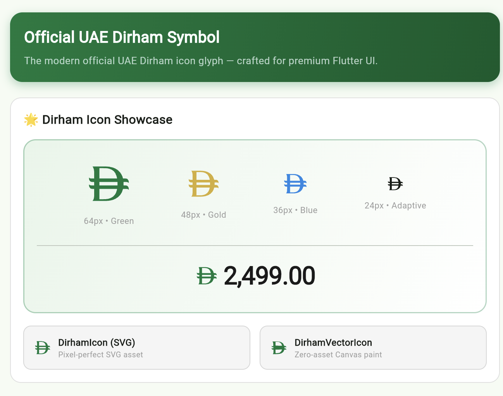
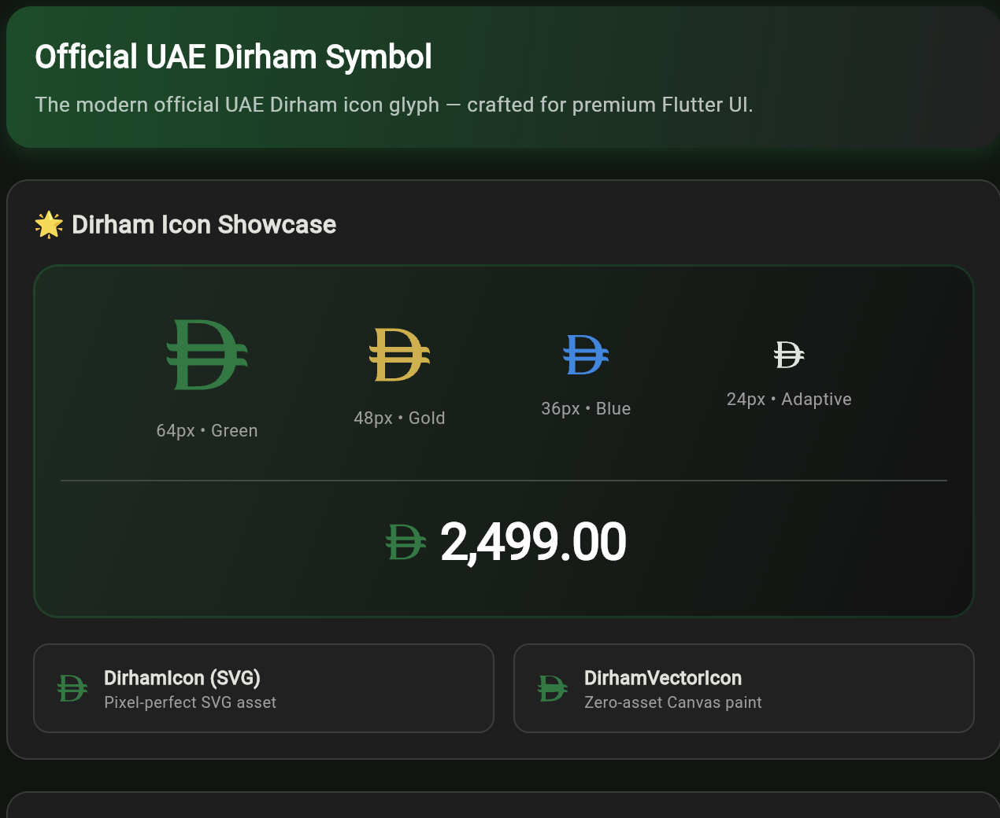
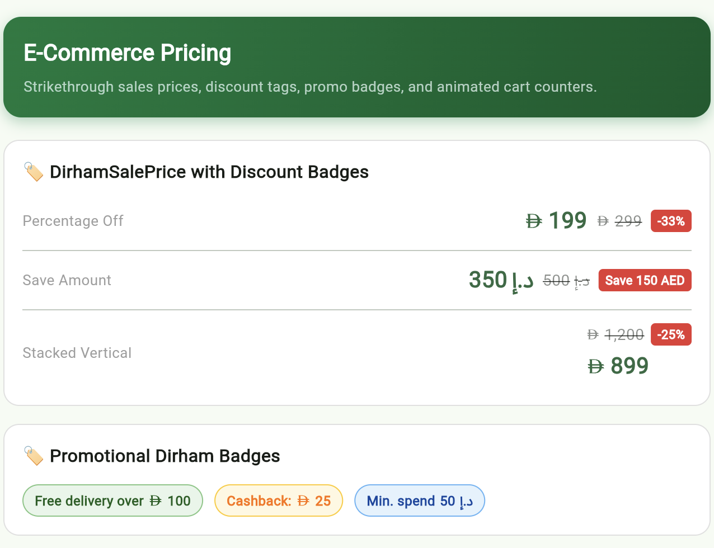

# Dirham Symbol (`dirham_symbol`) 🇦🇪

[](https://pub.dev/packages/dirham_symbol)
[](https://pub.dev/packages/dirham_symbol/score)
[](https://opensource.org/licenses/MIT)
[](https://flutter.dev)

Display the **official UAE Dirham (AED) symbol** and format currency amounts in Flutter with **one line of code**.

Lightweight, zero external SVG dependencies, and works out-of-the-box as a **Widget**, **Icon**, or **formatted `String`**.

---

## 📦 Installation

```yaml
dependencies:
  dirham_symbol: ^0.5.2
```

```dart
import 'package:dirham_symbol/dirham_symbol.dart';
```

---

## ⚡ 10-Second Quick Start

### 1. Display Price as a Widget (`.toDirham()`)

Works directly on `int`, `double`, or `String`:

```dart
// Official Dirham symbol + formatted amount
99.99.toDirham()                                   // 99.99 (with official symbol)
1500.toDirham()                                    // 1,500 (with official symbol)
250.toDirham(symbolType: DirhamSymbolType.arabic)  // 250 د.إ
"1,500.50".toDirham()                              // 1,500.50 (parses formatted strings too!)

// Custom styling
99.99.toDirham(
  style: const TextStyle(fontSize: 22, fontWeight: FontWeight.bold, color: Colors.green),
)
```

### 2. Format as a `String` (`.toDirhamString()` & `.toDirhamGlyphString()`)

Need a formatted `String` instead of a widget?

```dart
// Standard text symbols (AED, د.إ, Dh)
1500.toDirhamString()                                           // "AED 1,500"
99.99.toDirhamString()                                          // "AED 99.99"
1500.50.toDirhamString(symbolType: DirhamSymbolType.arabic)     // "1,500.50 د.إ"
2500000.toDirhamCompact()                                       // "AED 2.5M"

// Official Dirham Font Glyph inside a standard Flutter Text widget:
Text(
  99.99.toDirhamGlyphString(),
  style: const DirhamTextStyle(fontSize: 20, fontWeight: FontWeight.bold),
)
```

### 3. Standalone Dirham Icon (`DirhamIcon`)

```dart
const DirhamIcon(
  size: 28,
  color: Color(0xFF007A3D),
)
```

---

## 🔣 Symbol Types

| Type | Output | Best For |
|:-----|:-------|:---------|
| `DirhamSymbolType.icon` | **Official UAE Dirham Glyph** (Default) | Modern UAE apps |
| `DirhamSymbolType.arabic` | **د.إ** | Arabic & RTL interfaces |
| `DirhamSymbolType.aed` | **AED** | International & banking apps |
| `DirhamSymbolType.dh` | **Dh** | Compact abbreviations |

---

## 📱 Screenshots

<table>
  <tr>
    <td align="center"><b>🌟 Official Symbol (Light)</b></td>
    <td align="center"><b>🌙 Official Symbol (Dark)</b></td>
    <td align="center"><b>🛍️ E-Commerce & Badges</b></td>
  </tr>
  <tr>
    <td></td>
    <td></td>
    <td></td>
  </tr>
</table>

---

## 🛠️ Classic Widgets & More Features

### Traditional Widgets (Alternative to Extensions)

```dart
// Basic price widget
const DirhamPrice(
  amount: 150.00,
  showDecimals: true,
  symbolType: DirhamSymbolType.icon,
  style: TextStyle(fontSize: 24, fontWeight: FontWeight.bold),
)

// Inline sentence with price
const InlineDirhamText(
  prefix: 'Starting from',
  amount: 99,
  suffix: 'only!',
)
// Or via extension: 99.toDirhamText(prefix: 'Starting from', suffix: 'only!')

// Price range
const DirhamPriceRange(minAmount: 50, maxAmount: 150)
// Or via extension: 50.toDirhamRange(150)
```

### E-Commerce Sale Prices & Badges

Display strikethrough original prices, discounted sale prices, and auto-calculated discount badges:

```dart
// Quick extension (auto-calculates -25% badge)
200.toDirhamSale(150)

// Full widget customization
const DirhamSalePrice(
  originalAmount: 500,
  saleAmount: 350,
  badgeType: DirhamDiscountBadgeType.percentage, // or .saveAmount
  axis: Axis.horizontal,                         // or Axis.vertical
)

// Promotional pill badge
DirhamBadge(
  amount: 100,
  prefix: 'Free delivery over',
  backgroundColor: Colors.green.shade50,
  textColor: Colors.green.shade900,
)
```

### Currency Input Field & Formatter

Live thousands separator formatting (`1,250.00`) for forms and checkout screens:

```dart
DirhamTextField(
  initialAmount: 250.0,
  showClearButton: true,
  decoration: const InputDecoration(
    labelText: 'Amount',
    border: OutlineInputBorder(),
  ),
  onAmountChanged: (double? amount) {
    // Parsed double value (e.g. 250.0)
  },
)

// Or use DirhamInputFormatter inside your own TextField:
TextField(
  keyboardType: const TextInputType.numberWithOptions(decimal: true),
  inputFormatters: [DirhamInputFormatter(decimalDigits: 2)],
)
```

### Animated Price Counter

Smoothly animate balance or cart total changes:

```dart
AnimatedDirhamPrice(
  amount: cartTotal,
  duration: const Duration(milliseconds: 500),
  style: const TextStyle(fontSize: 24, fontWeight: FontWeight.bold),
)
```

### App-Wide Default Theme (`DirhamTheme`)

Set your preferred symbol type, locale, or decimal behavior once at the app root:

```dart
DirhamTheme(
  data: const DirhamThemeData(
    symbolType: DirhamSymbolType.arabic,
    showDecimals: true,
  ),
  child: MyApp(),
)
```

### Subunit (Fils) & String Parsing Helpers

```dart
10.50.toFils()                     // 1050 (1 AED = 100 Fils)
2500.filsToDirham()                // 25.0
2500.filsToDirhamString()          // "AED 25.00"
"AED 1,250.50".cleanDirhamAmount() // 1250.50
```

---

## 📄 License

MIT License - see [LICENSE](LICENSE) for details.
